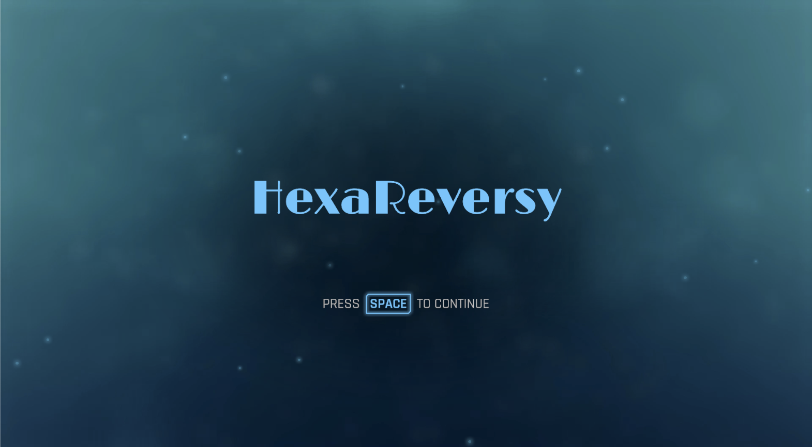
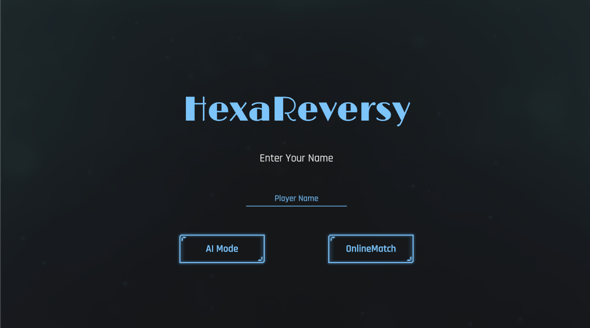
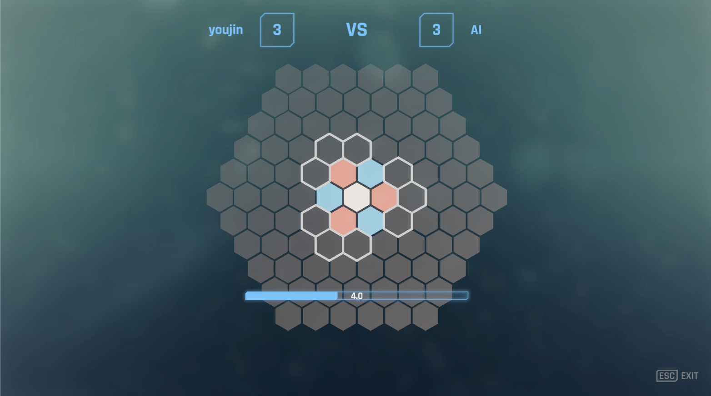

# HexaReversy

육각형 타일 위에서 즐기는 **리버시(오셀로) 변형 3D 대전 게임**입니다.
Unity 6 + Photon PUN 2로 제작했으며, 온라인 1:1 대전과 AI 대전 모드를 지원합니다.

| 타이틀 | 로그인 / 매칭 | 플레이 |
|:---:|:---:|:---:|
|  |  |  |

---

## 게임 소개

- 육각형(Hex) 보드 위에서 두 플레이어가 번갈아 타일을 놓습니다.
- 내 타일을 놓았을 때 **6방향** 중 상대 타일이 내 타일 사이에 끼면 모두 뒤집힙니다.
- 보드 중앙의 **Center 타일**은 중립 타일이며, 뒤집기 판정에서 *양쪽 모두의 타일처럼* 취급됩니다.
- 각 플레이어는 3개의 타일로 시작합니다 (선공 Blue / 후공 Red).
- 한 턴의 제한 시간은 **10초**이며, 시간 안에 놓지 못하면 놓을 수 있는 칸에 자동으로 놓입니다.
- 놓을 수 있는 칸이 없으면 **Pass** 후 상대 턴으로 넘어갑니다.
- 중앙을 제외한 모든 칸이 채워지면 게임이 끝나고, 타일이 더 많은 쪽이 승리합니다 (동점이면 Deuce).

### 조작법

| 입력 | 동작 |
|---|---|
| 마우스 왼쪽 클릭 | 하이라이트된 칸에 타일 놓기 |
| 마우스 오른쪽 드래그 | 카메라 이동 (Pan) |
| 마우스 휠 | 줌 인/아웃 |
| ESC | 메뉴 열기/닫기 (멀티 모드에서는 나가기 비활성) |

---

## 주요 기능

- **온라인 1:1 매칭** — Photon 로비 접속 후 랜덤 룸 입장, 빈 룸이 없으면 직접 생성(최대 2인). 2명이 모이면 룸을 닫고 자동으로 게임 씬으로 이동합니다. 리전은 `kr`로 고정되어 있습니다.
- **AI 대전 모드** — 별도 씬(`AIModeScene`)에서 AI와 대전합니다.
- **상태 동기화** — 턴 전환, 타일 놓기, 뒤집기 각도/회전 애니메이션을 모두 `PunRPC`로 동기화합니다.
- **뒤집기 연출** — 방향별로 순서대로 0.15초 간격으로 타일이 회전하며 뒤집히고, 효과음이 재생됩니다.
- **놓을 수 있는 칸 하이라이트** — QuickOutline으로 선택 가능한 칸을 표시하고, 마우스 호버 시 머티리얼과 사운드로 피드백을 줍니다.
- **리매치 / 타이틀 복귀** — 게임 종료 UI에서 RPC로 양쪽 모두 게임 씬을 다시 로드합니다.

---

## 기술 스택

| 분류 | 내용 |
|---|---|
| Engine | Unity **6000.0.20f1** (Unity 6), URP 17 |
| Network | Photon PUN 2 (Photon Realtime / Chat 포함) |
| Language | C# |
| UI | uGUI, TextMesh Pro, Shift - Complete Sci-Fi UI |
| Asset | KayKit Medieval Hexagon Pack, Free UI Click Sound Effects Pack, QuickOutline |
| Editor Tool | vSeries (vHierarchy / vFolders / vInspector) |

---

## 프로젝트 구조

```
Assets/
├── 01_Scenes/
│   ├── TitleScene.unity      # 닉네임 입력, 매칭
│   ├── GameScene.unity       # 온라인 1:1 대전
│   ├── AIModeScene.unity     # AI 대전
│   └── Reference / TileTest  # 테스트용 씬
├── 02_Script/
│   ├── ForGameStart/
│   │   ├── PhotonManager.cs      # 서버 접속, 로비/룸 입장·생성 콜백
│   │   └── GameStartManager.cs   # 매칭 완료 연출, 씬 전환 RPC
│   ├── GamePlay/
│   │   ├── GameManager.cs        # 전역 설정(제한 시간, 맵 크기, AI 모드), 씬 리로드
│   │   ├── Player.cs             # StateMachine 소유, 상태 전환을 RPC로 동기화
│   │   ├── TileManager.cs        # 보드 데이터, 경계 탐색, 뒤집기 판정, 종료 판정
│   │   ├── TileInfo.cs           # 개별 타일 상태·좌표, 뒤집기 코루틴, RPC
│   │   ├── Cube.cs               # 육각형 Cube 좌표(q, r, s) ↔ odd-r 오프셋 변환
│   │   ├── MouseManager.cs       # 레이캐스트 호버/클릭 처리
│   │   ├── Rotate.cs             # 타일 180° 회전 애니메이션
│   │   ├── CameraMove.cs         # 카메라 줌/팬
│   │   └── UI/UIManager.cs       # 점수, 타이머, Pass, 승패, ESC UI
│   ├── StateMachine/
│   │   ├── IState.cs             # Enter / Excute / Exit
│   │   ├── StateMachine.cs
│   │   └── State/                # GameStart, TurnPlayer1, TurnPlayer2, TurnAI, End, Win, Lose
│   ├── AudioManager.cs           # 효과음 싱글턴 (DontDestroyOnLoad)
│   └── CoroutineRunner.cs        # 코루틴 완료 후 콜백 실행 유틸
├── 03_Material ~ 07_Mesh         # 머티리얼, 프리팹, 이미지, 애니메이션, 메시
└── Resources/PlayerColor         # 플레이어별 타일 머티리얼
```

---

## 핵심 구현

### 1. 육각형 좌표계 (Cube Coordinates)

Unity `Tilemap`의 hex 셀 좌표(odd-r 오프셋)를 **Cube 좌표 (q, r, s, q+r+s=0)** 로 변환해 사용합니다.
Cube 좌표에서는 6방향 이웃이 고정 벡터 덧셈으로 표현되므로 직선 탐색이 단순해집니다.

```csharp
Vector3Int[] direction = {
    new(1, 0, -1), new(0, 1, -1), new(-1, 1, 0),
    new(-1, 0, 1), new(0, -1, 1), new(1, -1, 0)
};
```

`Cube`는 `Equals` / `GetHashCode`를 재정의해 `Dictionary<Cube, TileInfo>`의 키로 사용합니다.

### 2. 놓을 수 있는 칸 탐색

1. **경계 탐색 (`FindBoundary2`)** — 빈 타일 중 6방향 이웃에 이미 놓인 타일이 하나라도 있는 칸을 후보로 수집합니다.
2. **뒤집기 판정 (`FindFlippableTiles`)** — 각 후보에서 6방향으로
   - 빈 칸/맵 끝이 나오기 전까지 놓인 타일을 스택에 쌓고,
   - 위에서부터 내 타일(또는 Center)이 나올 때까지 pop,
   - 다시 상대 타일이 나올 때까지 pop하면 남은 것이 뒤집을 타일입니다.
3. 뒤집을 타일이 1개 이상인 칸만 `SelectableBoundaryTile`로 하이라이트합니다.

방향별 스택(`Stack<Cube>[6]`)은 타일에 저장해 두었다가 착수 시 `FlipWithDelay()` 코루틴에서 순서대로 뒤집습니다.

### 3. 상태 머신 + 네트워크 동기화

```
GameStartState ──(2.5s)──▶ TurnPlayer1 ⇄ TurnPlayer2 / TurnAI ──(보드 가득 참)──▶ EndState
```

- 각 턴 상태는 `PunActorNumber`로 자기 차례인지 확인하고, 자기 차례일 때만 마우스 입력을 활성화합니다.
- `StateMachine`은 `PhotonView`를 가질 수 없으므로, `Player.TransitionTo()`가 상태 **클래스 이름**을 `SyncStateTransition` RPC로 전송해 모든 클라이언트가 동일하게 전환합니다.
- 뒤집기 코루틴이 끝난 뒤 다음 턴으로 넘어가도록 `CoroutineRunner.RunCoroutine(coroutine, onComplete)`로 콜백을 연결했습니다.

### 4. AI 모드

`TurnAI`는 후공(State 2)으로 동작하며, 놓을 수 있는 칸 중 첫 번째 칸에 착수합니다. 놓을 곳이 없으면 바로 플레이어 턴으로 넘어갑니다.

---

## 실행 방법

1. **Unity Hub**에서 Unity **6000.0.20f1**로 프로젝트 폴더를 엽니다.
2. Photon 설정
   - [Photon Dashboard](https://dashboard.photonengine.com/)에서 PUN 앱을 만들고 App ID를 발급받습니다.
   - `Window > Photon Unity Networking > Highlight Server Settings`에서 **App Id PUN**을 입력합니다.
3. `Assets/01_Scenes/TitleScene.unity`를 열고 Play 합니다.
4. 온라인 대전 테스트는 빌드한 실행 파일과 에디터(또는 빌드 2개)를 동시에 실행해 닉네임을 입력하고 접속하면 됩니다.

빌드 씬 순서: `TitleScene` → `GameScene` → `AIModeScene`

---

## 알려진 이슈 / 개선 예정

- [ ] AI가 첫 번째 가능한 칸에 놓는 단순 전략 → 랜덤 또는 최대 뒤집기(그리디)/미니맥스 전략으로 개선
- [ ] 시간 초과 시 자동 착수도 첫 번째 칸 → 랜덤 착수
- [ ] 매 턴 전체 빈 타일을 다시 탐색 → 변경된 부분만 갱신하도록 최적화
- [ ] `WinState` / `LoseState`는 구현만 되어 있고 미사용 (현재 `EndState`에서 승패 표시)
- [ ] 룸 이름이 닉네임 기반이라 닉네임 중복 시 룸 생성 실패 가능
- [ ] 맵 크기(`MapSize`) 설정 기능

---

## 만든 사람

- **김유진** ([@youjin-43](https://github.com/youjin-43))
- 개발 기간: 2024.11 ~ 2025.04
